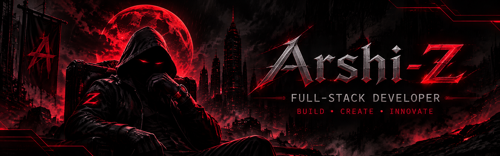

<div align="center">
  
</div>
<div align="center">


</div>

---

<div align="center">

### `01 // IDENTITY`

**Z** — Full-Stack Developer

*Engineering digital experiences in a world of endless possibilities.*

</div>

```bash
┌──[Z@developer]
└─$ whoami

Name       : Z
Role       : Full-Stack Developer
Focus      : Web Development
Environment: Linux / Windows
Mindset    : Build. Learn. Improve.
Status     : Always evolving...
```

---

### `02 // TECHNOLOGIES`

<div align="center">


</div>

---

### `03 // GITHUB ANALYTICS`

<div align="center">


</div>

---

### `04 // ACTIVITY MONITOR`

<div align="center">


</div>

---

<div align="center">

### `ACCESS GRANTED`


<sub>DESIGNED BY Z // DIGITAL ENVIRONMENT</sub>

</div>
